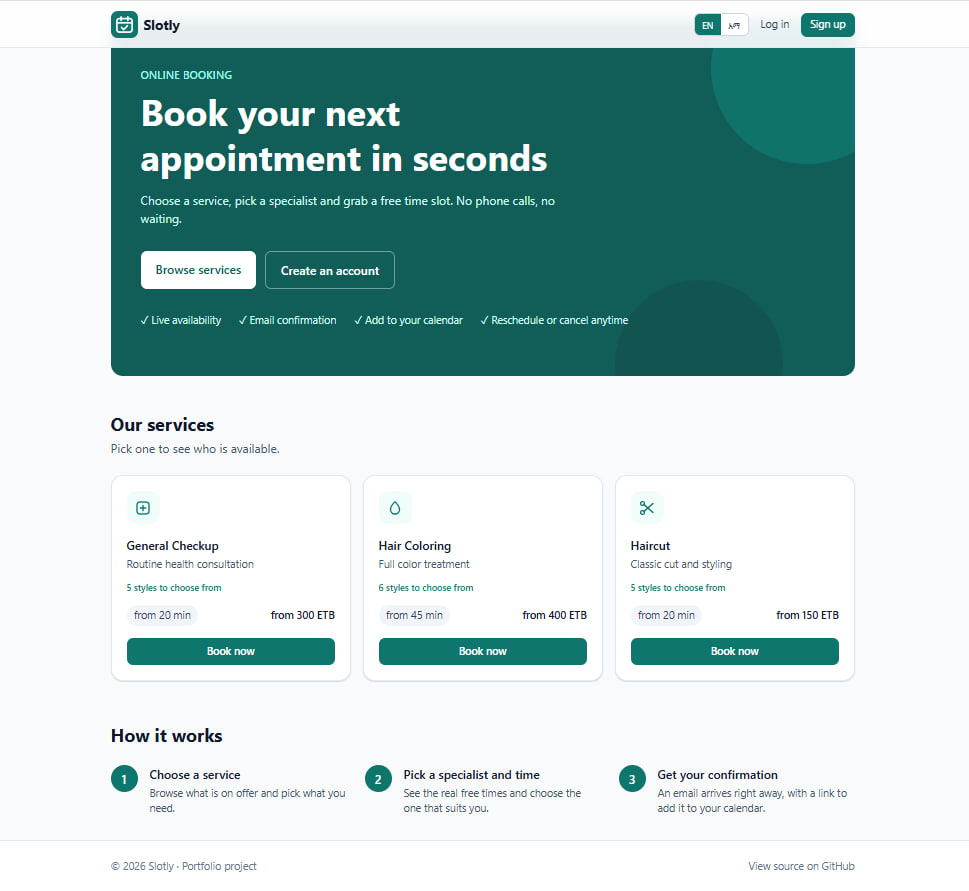
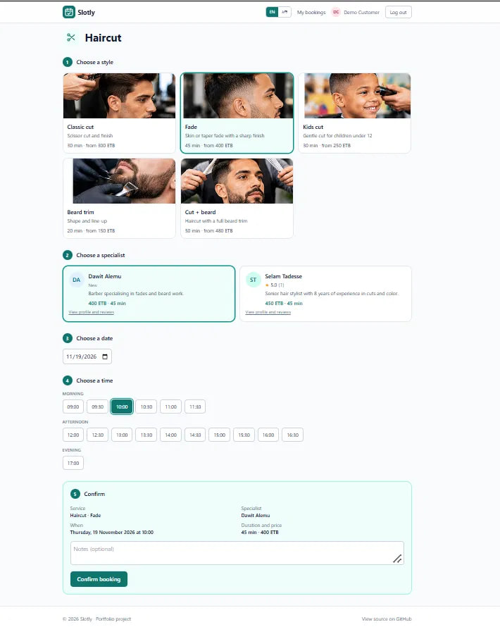
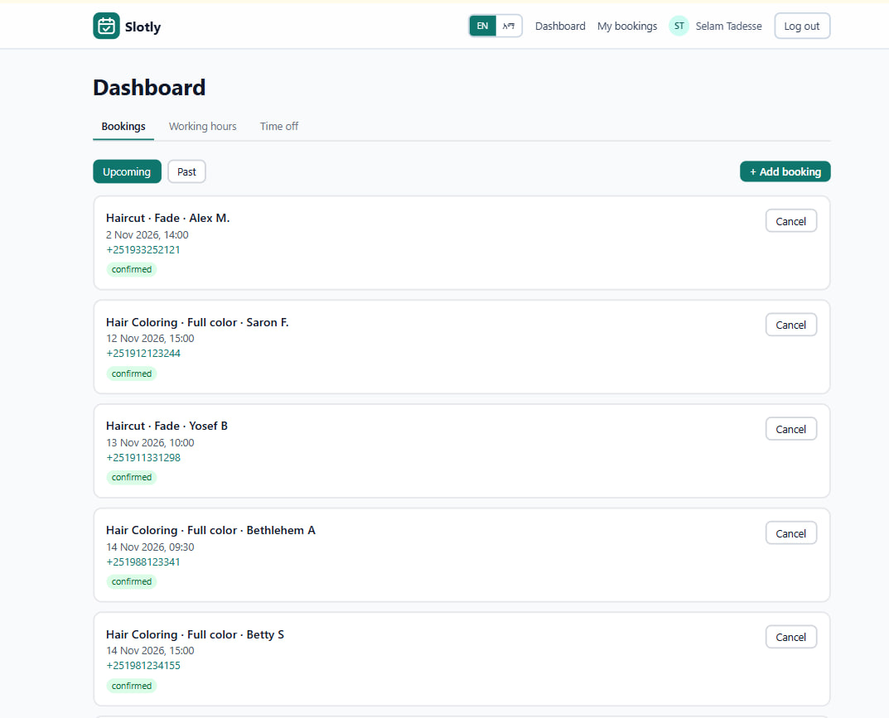
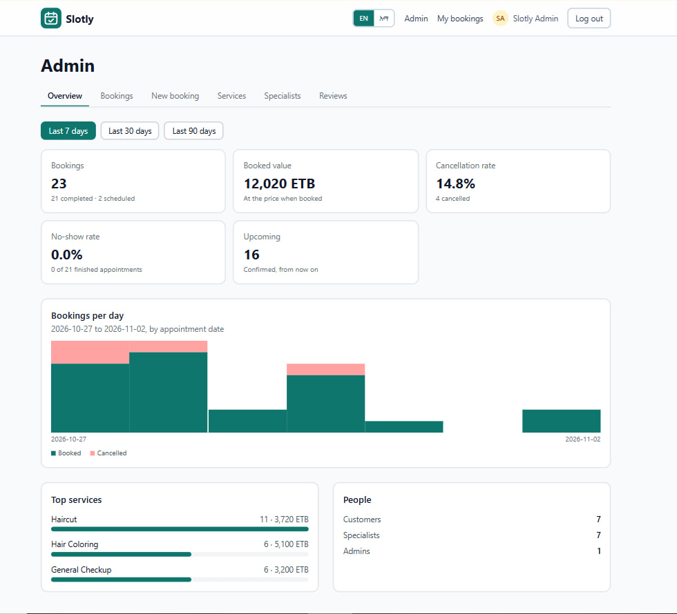
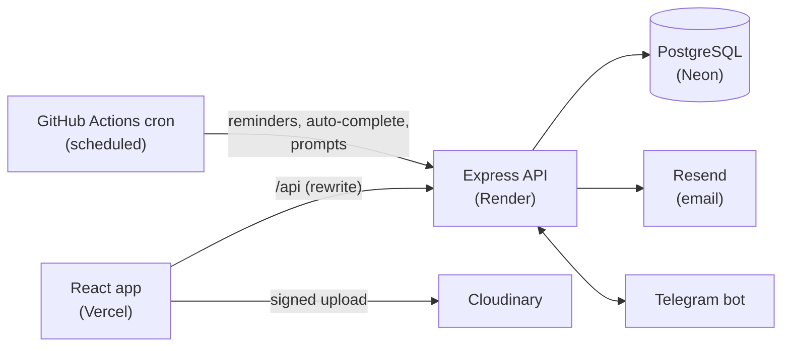

# Slotly

**Appointment booking for salons, clinics and other service businesses, built for Ethiopia: Amharic and English, Telegram notifications, no-show tracking, and double-booking prevented by the database itself.**

[](https://github.com/habte2112/slotly/actions/workflows/ci.yml)

- **Live demo:** https://slotly-rosy.vercel.app (installable on a phone as an app). Use the **"Try the demo"** buttons on the login page to sign in as a customer, a specialist or an admin in one click.
- **API:** https://slotly-api-nsfp.onrender.com/api/ping
- The API runs on a free tier and may take up to a minute to wake up on the first request.
- This is a demo with sample data. Please do not enter real personal information.



## Why it exists

Many salons and clinics still take bookings by phone and write them in a notebook, and a large share of appointments end in a no-show. Slotly keeps that workflow (specialists can add phone and walk-in customers themselves) while giving customers self-service booking, giving specialists a no-show history for each customer, and sending reminders where people already are: Telegram.

## What it does

### Customers
- Browse services, pick a **style** (for example Fade or Classic cut), a specialist, a date and a time slot
- See the price and duration that apply to that specific specialist and style
- Cancel or reschedule; rate completed visits and read specialist profiles and reviews
- Receive an email confirmation with a calendar file (.ics) and an "Add to Google Calendar" link
- Receive reminders on **Telegram**; ask the bot for `/bookings` or `/cancel`
- Use the whole interface in **Amharic or English**; in Amharic, times are also shown on the Ethiopian clock (10:00 becomes "ጠዋት 4 ሰዓት")
- Install the site on a phone as an app (PWA)



### Specialists (providers)
- Dashboard with upcoming and past bookings; mark a booking as completed, cancelled or **no-show**
- **Add bookings for phone and walk-in customers**; they need no account and are recognised by phone number
- See a customer's earlier no-shows next to the booking
- Telegram: new-booking alerts, `/today`, and a message after each appointment asking "did the customer come?" with one-tap buttons
- Weekly working hours and time off (refused if it would cover existing bookings)
- Bookings that nobody marks are completed automatically after 24 hours



### Admins
- Statistics: bookings per day, revenue, cancellation and no-show rates, top services
- Manage services and styles (add, hide, upload an image); assign styles to specialists with their own price and duration
- Promote a customer to a specialist; hide inappropriate reviews
- Change their own password from the account page



### White-labelling
Brand name, logo, favicon, PWA manifest and default language are set by environment variables at build time. One codebase serves the public demo and a separate deployment prepared for a real barbershop in Addis Ababa.

## Engineering highlights

### Double-booking is impossible, not just unlikely
Checking "is the slot free?" in application code is a race condition: two requests can pass the check at the same moment. Slotly puts the rule in PostgreSQL instead, with an exclusion constraint:

```sql
EXCLUDE USING gist (
  "providerId" WITH =,
  tsrange("startAt", "endAt") WITH &&
) WHERE (status IN ('PENDING', 'CONFIRMED'))
```

The API turns the constraint violation into a clean `409`. A test fires five simultaneous requests for the same slot and asserts that exactly one wins. Because the constraint only covers pending and confirmed bookings, completed, cancelled and no-show records never block the calendar.

### Time handled deliberately
All timestamps are stored in UTC. Business rules (working hours, "today", the 30-minute grid) are evaluated in `Africa/Addis_Ababa`. Availability is a **pure function** (`computeAvailableSlots`) that is unit-tested without a database. The Ethiopian 12-hour clock (six hours offset from the 24-hour clock) is a small tested function used in the web app and the bot.

### Styles with per-specialist pricing
A service can have styles (`ServiceVariant`). Each specialist can offer a style at the default price and duration or with their own override (`ProviderVariant`). The server resolves the final terms, so the client cannot choose its own price. The price is **snapshotted** on the booking, so later price changes never alter existing bookings. Rescheduling keeps the booking's own length.

### Walk-ins and no-shows without accounts
A specialist can book a customer by name and phone. The customer becomes a guest user, de-duplicated by normalised phone number (`+251...`), so a regular's no-show count follows them across visits. Guests get a random unusable password and an invalid email address; email, reminders and Telegram are skipped for them. A booking can only be marked completed or no-show after it has started.

### Telegram that cannot message twice
The "did the customer come?" prompt is claimed with a conditional database update before it is sent, so two overlapping cron runs send one message. Pressing the button twice is safe for the same reason: the status change only succeeds once. Every button checks that the booking belongs to the chat that pressed it.

### Two languages, checked by the compiler
UI strings live in typed dictionaries; the Amharic file must contain every English key, so a missing translation is a compile error rather than a blank label. The bot has its own dictionary, and a test asserts that Amharic and English messages use the same placeholders. Each user's language is stored on the server so Telegram speaks the language they chose on the site.

## Security

- Passwords hashed with bcrypt; JWT (HS256); a role sent by the client is ignored
- JWTs issued before a password change are rejected (`passwordChangedAt`)
- Password-reset and Telegram link tokens are stored **hashed** (SHA-256), single use, with expiry
- Rate limits on login (per email), registration and forgot-password; `helmet`; Zod validation of all input and of environment variables at startup
- Login and forgot-password give the same answer whether or not the account exists
- Scheduled endpoint protected by a secret compared in constant time; Telegram webhook verified by a secret header
- Image uploads use **signed direct uploads** to Cloudinary; the API secret never reaches the browser, and only URLs from our own account are accepted
- Demo accounts cannot change their password

## Tech stack

| Area | Tools |
| --- | --- |
| Frontend | React, TypeScript, Vite, Tailwind CSS v4, React Router, installable PWA |
| Backend | Node.js, Express 5, TypeScript, Zod |
| Database | PostgreSQL (Neon), Prisma 7 with the `pg` driver adapter |
| Email / bot | Resend, Telegram Bot API |
| Images | Cloudinary (optional) |
| Testing / CI | Vitest, supertest, GitHub Actions, Dependabot |
| Hosting | Vercel (client), Render (API), Neon (database) |

## Architecture



```
client/   React app (pages, components, i18n, API client)
server/   Express API (routes, controllers, availability engine, Prisma schema, tests)
```

## API overview

| Area | Endpoints |
| --- | --- |
| Auth | `POST /api/auth/register`, `/login`, `/forgot-password`, `/reset-password`, `/change-password`, `GET /api/auth/me`, `PATCH /api/auth/locale` |
| Catalog | `GET /api/services`, `GET /api/providers`, `GET /api/providers/:id/availability` |
| Bookings | `POST /api/bookings`, `GET /api/bookings/my`, `PATCH /api/bookings/:id/cancel`, `/reschedule` |
| Reviews | `POST /api/bookings/:id/review`, `GET /api/providers/:id/reviews`, `GET /api/reviews/summary`, `/mine` |
| Specialist | `/api/provider/me`, `/working-hours`, `/time-off`, `GET` / `POST /api/provider/bookings`, `PATCH /api/provider/bookings/:id/status` |
| Admin | `/api/admin/stats`, `/bookings`, `/services`, `/providers`, `/reviews`, styles and images |
| Telegram | `/api/telegram/status`, `/link`, webhook |
| Scheduled | `POST /api/internal/send-reminders` (reminders, auto-complete, outcome prompts) |
| Health | `GET /api/health`, `GET /api/ping` |

## Testing

```bash
cd server
npm test
```

132 tests: availability logic, calendar files, style pricing, phone normalisation, Cloudinary signing, bot messages and the Ethiopian clock, plus API integration tests covering auth, roles, booking, concurrency, reschedule, time off, password reset and change, reviews, no-shows, walk-in bookings, auto-completion, admin and Telegram. Integration tests run against a separate database and are skipped unless `TEST_DATABASE_URL` is set. CI runs them on every push.

## Run locally

Requirements: Node.js 20+, a PostgreSQL database (a free Neon project works).

```bash
git clone https://github.com/habte2112/slotly.git
cd slotly

# API
cd server
cp .env.example .env      # fill in the values
npm install
npx prisma migrate deploy --config prisma7.config.ts
npm run seed
npm run dev

# Client (second terminal)
cd client
npm install
npm run dev
```

Main environment variables (see `server/.env.example`): `DATABASE_URL`, `JWT_SECRET`, `CLIENT_URL`, `APP_URL`, `RESEND_API_KEY`, `TELEGRAM_BOT_TOKEN`, `TELEGRAM_BOT_USERNAME`, `TELEGRAM_WEBHOOK_SECRET`, `CRON_SECRET`, and the optional `CLOUDINARY_CLOUD_NAME`, `CLOUDINARY_API_KEY`, `CLOUDINARY_API_SECRET`. Email, Telegram and image upload are optional; the app works without them.

To run a real (non-demo) instance, build the client with `VITE_DEMO=false`; this removes the demo banner and the portfolio footer. Branding is set with `VITE_BRAND_NAME`, `VITE_BRAND_SHORT`, `VITE_BRAND_DESCRIPTION`, `VITE_BRAND_ASSETS` and `VITE_DEFAULT_LOCALE`.

## Demo accounts

Public accounts with fake data. Password changes are disabled on the demo.

| Role | Email | Password |
| --- | --- | --- |
| Customer | customer@slotly.dev | Customer123 |
| Specialist | selam@slotly.dev | Provider123 |
| Admin | admin@slotly.dev | Admin12345 |

## Known limitations and roadmap

- Slots use a fixed 30-minute grid
- Email goes through Resend's test sender until a custom domain is verified, so the demo can only email the account owner (Telegram has no such limit)
- Dates use Gregorian months, in Amharic names; the Ethiopian calendar is not supported yet
- The admin panel is English only; service and style names come from the database and are not translated
- Server error messages are translated in the browser by matching their English text, so messages not on that list stay in English
- The free API tier sleeps when idle; a real deployment should use an always-on instance
- Planned: receptionist role, online deposits (Chapa), custom domain with verified email, per-specialist photos, support for several businesses, 15-minute slot grid

## License

See [LICENSE](LICENSE).

## Author

Built by **Habte Addis**, a full-stack developer based in Addis Ababa. Available for freelance work: [Upwork profile](https://www.upwork.com/freelancers/~01654e6b535eb97b65) · [GitHub](https://github.com/habte2112)